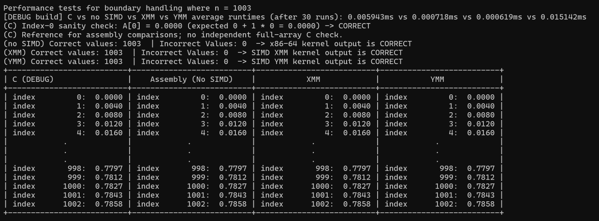
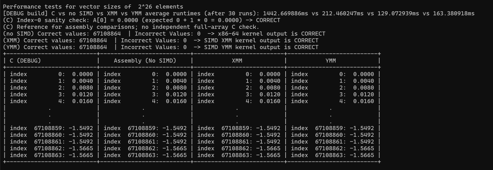
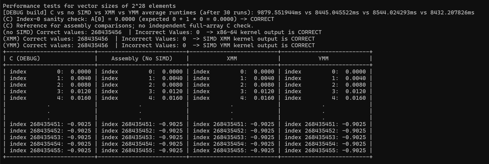
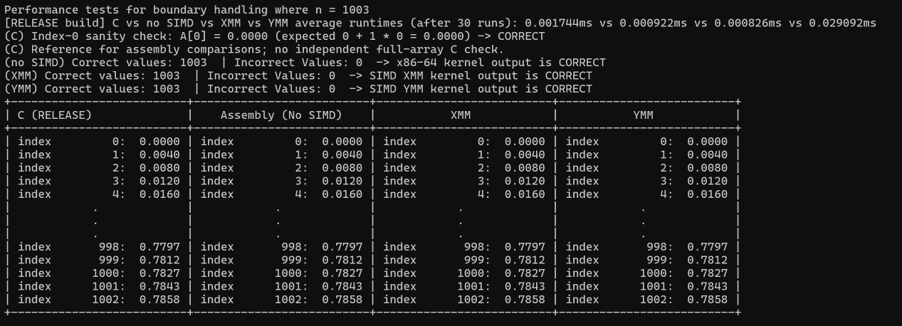
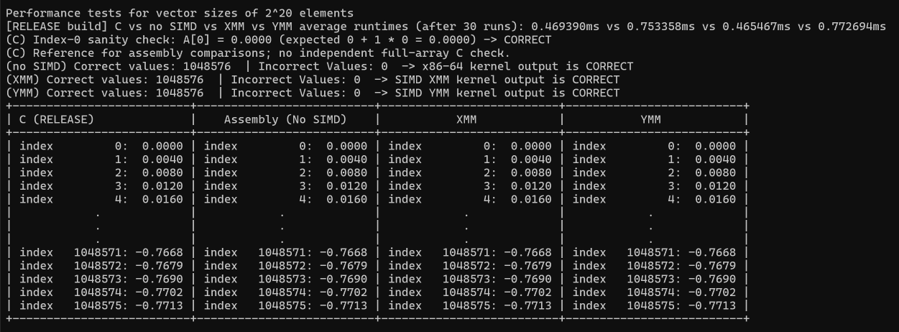
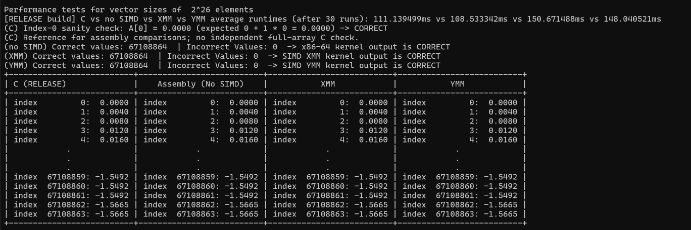
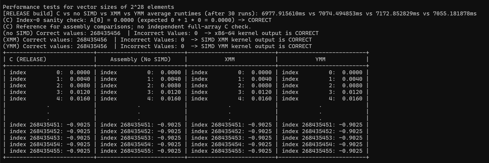

# CEPARCO-SIMD-programming-project
This CEPARCO project compares four implementations of the vector triad, a calculation that combines three input arrays into one output array.

- Measures average execution time over 30 runs in Debug and Release.
- Checks three assembly implementations against a C reference.
- Tests SIMD boundary handling and displays the first and last five answers.

## How to run

1. **Prepare the requirements.** Use Windows, Visual Studio 2026 with the C++ development tools and Windows SDK, a set of Windows development files, and NASM, the tool that assembles the `.asm` files. The project uses the v145 compiler toolset. The specification calls for an AVX2-capable CPU, a processor that supports the required vector instructions.

2. **Open the solution.** Open `CEPARCO programming project.slnx` in Visual Studio. Select **Debug** and **x64**, the target for 64-bit Intel and AMD instructions.

3. **Rebuild the project.** Choose **Build > Rebuild Solution** and check that the build succeeds. The project compiles the C files, assembles all three `.asm` files, and links their object files, the compiled parts, into one program. NASM must be available to the project through its configured executable or the system's command lookup.

4. **Run Debug.** Choose **Debug > Start Without Debugging** or press **Ctrl+F5**. No input is needed. The program runs 1,003, 2^20, 2^26, and 2^28 elements in that order. Wait for all four cases to finish and save their output before closing the console.

5. **Run Release.** Select **Release** and **x64**, rebuild the solution, and start without debugging again. Finish one configuration before starting the other so the two processes do not compete for memory.

6. **Check and record the results.** Each case should identify its build, show average times, and report zero incorrect values for scalar assembly, XMM, and YMM. Save one screenshot per size for each build, including the timing line, correctness lines, and full sample table.

The largest case needs 7 GiB for its arrays, where one GiB is 2^30 bytes, and can take several minutes to finish. Both configurations use the same inputs, sizes, and number of repetitions.

## a) Project report

### i. Execution time

The kernel, the calculation being timed, is `A[i] = B[i] + C[i] * D[i]`, where `i` selects one position in an array, a list of values. All four arrays use `float`, a 32-bit format for numbers with fractional parts.

C provides the reference calculation. Scalar assembly processes one float per arithmetic instruction. SIMD, single instruction, multiple data, processes a group at once: the XMM version uses four floats per group, while YMM uses eight. These names refer to processor registers, small storage areas used by instructions.

The inputs use the following formulas. `sinf` and `cosf` calculate sine and cosine with float values.

```c
B[i] = sinf(i * 0.001f);
C[i] = cosf(i * 0.002f);
D[i] = sinf(i * 0.003f);
```

Each version has its own output array, and the program runs each kernel 30 times for each size before reporting the mean in milliseconds. The eight screenshots below contain the timing, correctness counts, and first and last five answers. The correctness and boundary sections refer to this same evidence.

#### Debug results

**1,003 elements**



**2^20 elements**


**2^26 elements**



**2^28 elements**



#### Release results

**1,003 elements**



**2^20 elements**



**2^26 elements**



**2^28 elements**



### ii. Comparison of execution times

This table records the average milliseconds per kernel call over 30 runs. Lower is faster.

| Elements | Build | C (ms) | Scalar assembly (ms) | XMM (ms) | YMM (ms) |
| ---: | --- | ---: | ---: | ---: | ---: |
| 1,003 | Debug | 0.005943 | 0.000718 | 0.000619 | 0.015142 |
| 1,003 | Release | 0.001744 | 0.000922 | 0.000826 | 0.029092 |
| 1,048,576 (2^20) | Debug | 34.102181 | 0.396876 | 0.205758 | 0.231519 |
| 1,048,576 (2^20) | Release | 0.469390 | 0.753358 | 0.465467 | 0.772694 |
| 67,108,864 (2^26) | Debug | 1442.669886 | 212.460247 | 129.072939 | 163.380918 |
| 67,108,864 (2^26) | Release | 111.139499 | 108.533342 | 150.671488 | 148.040521 |
| 268,435,456 (2^28) | Debug | 9879.551944 | 8445.045522 | 8544.024293 | 8432.207826 |
| 268,435,456 (2^28) | Release | 6977.915610 | 7074.494853 | 7172.852829 | 7055.181878 |

Speedup is the reference time divided by the comparison time: a value above 1 means the comparison was faster, while a value below 1 means it was slower. For example, Release XMM versus scalar at 2^20 is `0.753358 / 0.465467 = 1.618` times as fast.

This table compares the kernels within each build. Ratios use the displayed times and are rounded to three decimal places.

| Elements | Build | Scalar vs C | XMM vs C | YMM vs C | XMM vs scalar | YMM vs scalar |
| ---: | --- | ---: | ---: | ---: | ---: | ---: |
| 1,003 | Debug | 8.277 | 9.601 | 0.392 | 1.160 | 0.047 |
| 1,003 | Release | 1.892 | 2.111 | 0.060 | 1.116 | 0.032 |
| 1,048,576 (2^20) | Debug | 85.927 | 165.739 | 147.298 | 1.929 | 1.714 |
| 1,048,576 (2^20) | Release | 0.623 | 1.008 | 0.607 | 1.618 | 0.975 |
| 67,108,864 (2^26) | Debug | 6.790 | 11.177 | 8.830 | 1.646 | 1.300 |
| 67,108,864 (2^26) | Release | 1.024 | 0.738 | 0.751 | 0.720 | 0.733 |
| 268,435,456 (2^28) | Debug | 1.170 | 1.156 | 1.172 | 0.988 | 1.002 |
| 268,435,456 (2^28) | Release | 0.986 | 0.973 | 0.989 | 0.986 | 1.003 |

The next table divides Debug time by Release time for the same kernel. Values above 1 mean Release was faster.

| Elements | C | Scalar assembly | XMM | YMM |
| ---: | ---: | ---: | ---: | ---: |
| 1,003 | 3.408 | 0.779 | 0.749 | 0.520 |
| 1,048,576 (2^20) | 72.652 | 0.527 | 0.442 | 0.300 |
| 67,108,864 (2^26) | 12.981 | 1.958 | 0.857 | 1.104 |
| 268,435,456 (2^28) | 1.416 | 1.194 | 1.191 | 1.195 |

C gains the most from Release at 2^20, falling from 34.102181 ms to 0.469390 ms for a 72.652x speedup, while its gain at 2^26 falls to 12.981x. The assembly results do not follow a single pattern: all three are slower in Release at 1,003 and 2^20 elements, while all three are faster at 2^28.

XMM has the lowest Release mean at 1,003 and 2^20 elements, scalar assembly at 2^26, and C at 2^28. The XMM lead over C at 2^20 is only 0.84%, and no range or standard deviation, a measure of variation between runs, is printed. That gap does not establish a repeatable winner.

Six decimal places keep the boundary times from appearing as zero. More printed digits do not improve timing accuracy, and ratios for these short calls are sensitive to measurement overhead.

### iii. Correctness of C

The [Debug results](#debug-results) and [Release results](#release-results) show the C index-0 sanity check as `CORRECT` for every size. At that index, the inputs are `B[0] = 0`, `C[0] = 1`, and `D[0] = 0`, giving `A[0] = 0 + 1 * 0 = 0`. The output is `0.0000` in every case.

C acts as the answer key for the other kernels, as allowed by the specification, but the program checks only its first value against a known answer and has no separate full-array check of C itself. The sample columns show the first and last five answers for inspection.

After all 30 repetitions, `testOutputs()` compares each assembly result with C using `!=`, the C operator for unequal numeric values, and checks the stored values with no rounding tolerance. The four-decimal sample display is not used in that comparison, and the program checks the final arrays rather than every repetition.

### iv. Correctness of x86-64 assembly without SIMD

Scalar assembly reports `x86-64 kernel output is CORRECT` for all four sizes in both builds. No value differs from C. The correct counts of 1,003, 1,048,576, 67,108,864, and 268,435,456 equal the full array lengths, so the check covers every final output rather than a sample.

The scalar rows in the [Debug results](#debug-results) and [Release results](#release-results) provide this evidence. This version uses XMM registers, but its multiply and add instructions operate on one float. A register name alone does not make the code SIMD.

### v. Correctness of SIMD XMM

XMM processes four floats per main-loop pass. It reports `SIMD XMM kernel output is CORRECT` with zero incorrect values at every size in both configurations.

For example, the 2^26 screenshots in the [Debug results](#debug-results) and [Release results](#release-results) each show 67,108,864 matches with C. The 1,003-element screenshots also check the three values left after the complete groups of four.

### vi. Correctness of SIMD YMM

YMM processes eight floats per main-loop pass using the same multiply-then-add formula, and every size in both builds reports `SIMD YMM kernel output is CORRECT` with zero incorrect values.

The 2^28 screenshots in the [Debug results](#debug-results) and [Release results](#release-results) each show 268,435,456 matches, covering the full final array beyond the ten answers printed in the sample table.

### vii. Boundary cases for XMM and YMM

The 1,003-element case leaves three values after the complete SIMD groups. A scalar tail, a loop that handles the remaining values one at a time, finishes each calculation.

This table shows how the two SIMD versions divide the work.

| Version | Complete groups | Values processed in groups | Remaining indices |
| --- | --- | ---: | --- |
| XMM | 250 groups of 4 | 1,000 | 1,000, 1,001, 1,002 |
| YMM | 125 groups of 8 | 1,000 | 1,000, 1,001, 1,002 |

Both boundary screenshots, under [Debug](#debug-results) and [Release](#release-results), show `0.7827`, `0.7843`, and `0.7858` at those final three indices in every column. XMM and YMM each report 1,003 matches and zero incorrect values.

The tails include every remaining element. This test covers a remainder of three; it does not test every possible remainder or arrays shorter than five elements.

### viii. Analysis

#### Test environment and timing

We used a computer with 16 GB of physical RAM, its installed working memory. Both Debug/x64 and Release/x64 ran in Visual Studio 2026 on Windows, with 30 calls per kernel for each size. These timings describe the tested setup.

`QueryPerformanceCounter`, a Windows timer, measures the interval around each kernel call, with allocation, input generation, correctness checks, and printing outside that interval. Every repetition runs C, scalar assembly, XMM, then YMM, with no separate untimed warm-up call.

#### Debug and Release

Debug keeps compiler optimizations, changes intended to reduce runtime, turned off so the program is easier to inspect. Release enables them. That distinction matters for C: its Release speedups are 3.408x, 72.652x, 12.981x, and 1.416x across the four sizes.

The three NASM files provide the same assembly instruction bodies to both builds, so switching to Release does not optimize those handwritten instructions in the way it optimizes C. Differences in their timings can come from the surrounding build, memory and cache state, or background work. Cache is small, fast memory near the processor. These measurements do not isolate those causes.

The 165.739x Debug XMM speedup over C at 2^20 compares handwritten SIMD with a C build that has compiler optimizations disabled; it cannot be read as a four-lane hardware speedup. Release C is the more useful baseline for judging whether assembly improves on optimized C.

#### Memory-bound or compute-bound

For large optimized arrays, the vector triad is memory-bound: moving data limits the useful gain from faster arithmetic. Each element performs two FLOPs, floating-point operations, through one multiply and one add, while reading three 4-byte values and writing one 4-byte result.

Arithmetic intensity, the amount of arithmetic per byte accessed, is:

```text
2 FLOPs / (3 reads × 4 bytes + 1 write × 4 bytes)
= 2 / 16
= 0.125 FLOP per byte
```

There is little arithmetic for each byte moved. Wider SIMD instructions reduce the arithmetic instruction count, but every result still needs the same inputs and output, making memory bandwidth, the amount of data moved per second, the main concern for large optimized cases.

This describes the workload. It does not mean every measured call reached a RAM bandwidth limit: Debug overhead, short calls, and cache reuse can dominate before that point. The 16-byte count describes explicit array access, not a direct measurement of physical memory traffic.

#### SIMD speedup and optimized C

A model that counts only arithmetic suggests 4x gains for XMM and 8x for YMM, but it leaves out memory access, loop control, and tail handling. It also assumes the C baseline performs scalar work; MSVC can turn suitable C loops into SIMD through auto-vectorization. No compiler instruction listing was checked here, so we do not claim which vector instructions this C build used.

YMM did not beat C in any Release case. At 2^26, it took 148.040521 ms against C's 111.139499 ms, or 1.332x as long. At 2^28, the difference narrowed to about 1.11%, with C still ahead. Wider registers did not guarantee a lower time.

YMM also takes longer than XMM in both 1,003-element tests. The cause remains unknown. These short timings include call and timer overhead, and there is no warm-up pass, so the result should not be used as a general comparison of register widths.

#### The largest test

Seven arrays stay allocated: three inputs and four outputs. This table shows their combined storage.

| Elements | Storage for seven float arrays |
| --- | ---: |
| 1,003 | 28,084 bytes |
| 2^20 | 28 MiB |
| 2^26 | 1.75 GiB |
| 2^28 | 7 GiB |

One MiB is 2^20 bytes. A 2^30 test would need 28 GiB for the arrays alone, exceeding the computer's 16 GB of physical RAM. The specification permits 2^28 or 2^29 as smaller cases. We used 2^28, which reduces the array storage to 7 GiB.

From 2^26 to 2^28, the arrays grow four times, but Release times grow by 47.606x to 65.183x. Array size alone does not explain that jump. Memory pressure and paging, where Windows moves memory contents to disk and reads them back when needed, may contribute, but their cost was not measured.

Installed RAM does not establish how much memory was available to the program during these runs. No page-fault or disk-activity measurements were recorded, so the timings cannot confirm paging as the cause. The output arrays are allocated with `calloc`, which supplies zeroed memory, without a separate first-write pass; their first timed writes may also incur page-initialization costs.

At 2^28, all four Release times are within 2.8% of the fastest result, while C's gain from Release has fallen to 1.416x compared with 72.652x at 2^20. This convergence fits a shared data-movement bottleneck that faster arithmetic alone cannot remove.

The final five answers at 2^28 are all `-0.9025` because converting those neighboring indices to `float` loses integer precision at that scale and gives them the same input values. The full-array comparison matters more than those five repeated samples.

### ix. Problems, solutions, and insights

This table records issues in the project and how they were handled.

| Issue | Handling or finding |
| --- | --- |
| 1,003 does not divide into groups of four or eight | Scalar tails process the last three elements. Both builds report zero differences from C. |
| Two-decimal timings displayed short calls as `0.00ms` | Six decimal places preserve the boundary-test timing in the output. |
| The C heading did not identify the configuration | The timing line and C column now state `DEBUG` or `RELEASE`. |
| Correctness counts needed a clear status | Each assembly check prints `CORRECT` or `INCORRECT`; C has a separate index-0 sanity check. |
| The XMM tail returned through the main-loop condition | Returning to `last` removes an extra comparison while keeping the same answers. |
| The YMM object was not included as expected during linking | The project lists the object output without a trailing space so the build can link the assembly function. |
| The requested 2^30 arrays would need 28 GiB | Use the allowed 2^28 case, which needs 7 GiB. Its timing increase exceeds the fourfold growth in array size. |
| The last five values at 2^28 repeat | Float index rounding explains the repeated inputs. Full-array comparisons check more than these samples. |
| Mean timings do not show variation | Report the observed rankings without treating small gaps as fixed performance advantages. |

The main insight is that more values per instruction do not ensure a faster program. Optimized C was fastest in the largest Release test, and the gap between kernels was under 2.8%. That pattern points to data movement as the stronger limit.

The results cover these inputs and sizes. C remains the reference, the output checks use the final arrays, and the timing order is fixed. The program also does not check for allocation failure before using the arrays, so available memory remains a practical limit.

## b) Source files and Visual Studio project

The following structure shows the source, project files, and images used by this report. Generated build folders are omitted.

```text
.
├── README.md
├── CEPARCO programming project.slnx
├── CEPARCO programming project/
│   ├── main.c
│   ├── cFunc.c
│   ├── noSIMDFunc.asm
│   ├── xmmFunc.asm
│   ├── ymmFunc.asm
│   ├── CEPARCO programming project.vcxproj
│   ├── CEPARCO programming project.vcxproj.filters
│   └── CEPARCO programming project.vcxproj.user
└── docs/images/
    ├── debug-1003.png
    ├── debug-2-20.png
    ├── debug-2-26.png
    ├── debug-2-28.png
    ├── release-1003.png
    ├── release-2-20.png
    ├── release-2-26.png
    └── release-2-28.png
```

This table explains the files needed to understand and build the project.

| File | Purpose |
| --- | --- |
| `main.c` | Generates inputs, calls each kernel 30 times, measures runtime, checks the final outputs, and prints the results |
| `cFunc.c` | Computes the vector triad in C and supplies the reference answers |
| `noSIMDFunc.asm` | Computes one float at a time with scalar assembly |
| `xmmFunc.asm` | Computes groups of four floats and finishes the remaining elements with a scalar tail |
| `ymmFunc.asm` | Computes groups of eight floats and finishes the remaining elements with a scalar tail |
| `.slnx` | Opens the solution in Visual Studio |
| `.vcxproj` | Defines the build configurations, compiler settings, and NASM assembly steps |
| `.vcxproj.filters` | Groups the files shown in Solution Explorer |
| `.vcxproj.user` | Stores per-user Visual Studio settings |
| `docs/images/` | Stores the Debug and Release screenshots embedded in this report |
